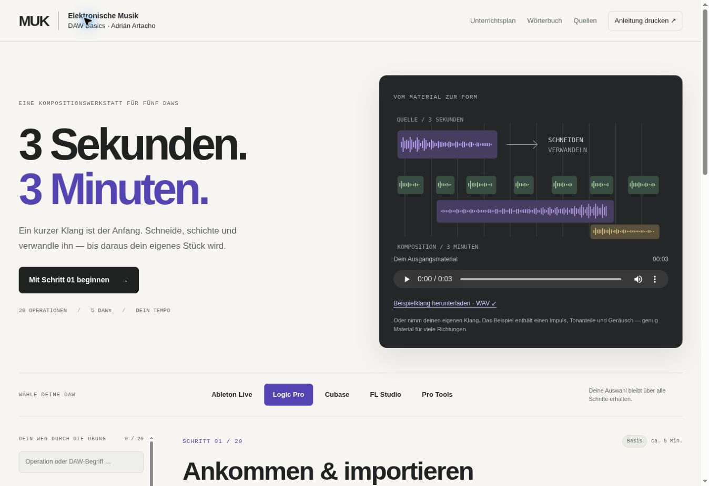

# [DAW Basics](https://adrianartacho.github.io/DAW-basics/)

**MUK / Elektronische Musik · Adrián Artacho**

Eine deutschsprachige Anleitung zu grundlegenden Audio-Operationen in **Ableton Live, Logic Pro, Cubase, FL Studio und Pro Tools**. Die Klasse geht Operation für Operation gemeinsam vor; jede Person folgt den Anleitungen für ihre DAW. Als durchgehendes Unterrichtsbeispiel entsteht aus einer ungefähr drei Sekunden langen Aufnahme ein etwa dreiminütiges Stück.



## Die Ressource

- **20 gemeinsame Operationen, 100 DAW-Anleitungen:** Konzept, kleiner Versuch, Hörfrage, konkrete Bedienung, Kontrollpunkt und Vertiefungsaufgabe.
- Ein DAW-Wechsel gilt für alle Schritte und bleibt in diesem Browser gespeichert.
- Vergleichsansicht und **DAW-Wörterbuch** verbinden die verschiedenen Bezeichnungen.
- Direkte Links öffnen eine bestimmte Operation und DAW, beispielsweise [`?daw=flstudio#fades`](https://adrianartacho.github.io/DAW-basics/?daw=flstudio#fades).
- Suchfeld für Operationen und DAW-Begriffe; lokal gespeicherte Fortschrittshäkchen.
- **12 echte Herstellerabbildungen**, direkt bei den passenden Anleitungen aufklappbar; zusätzlich eigene Prinzipdarstellungen.
- Ein eigens synthetisierter **3-Sekunden-Beispielklang** als WAV, mit aufklappbarem Player und Download in Schritt 01.
- Ein anpassbarer Unterrichtsplan für 90 Minuten und eine Druckansicht aller Schritte für die gewählte DAW.
- Ohne JavaScript bleiben alle Anleitungen untereinander lesbar. Keine externen Schriftarten, Tracker oder Laufzeitbibliotheken.

## Reihenfolge

| Phase | Schritte |
| --- | --- |
| Material entdecken | 01 Projekt & Import · 02 Schneiden · 03 Anordnen & Schichten · 04 Fades & Crossfades · 05 Pegel & Panorama · 06 Loops & Rhythmus |
| Zeit & Tonhöhe | 07 Reverse · 08 Pitch-Shift · 09 Repitch / Varispeed · 10 Time-Stretch · 11 Warp / Flex |
| Klang gestalten | 12 EQ & Filter · 13 Dynamikkompression · 14 Delay & Reverb · 15 Verzerrung & Effektketten · 16 Sends & Busse · 17 Automation |
| Ein Stück formen | 18 Resampling · 19 Form & Dramaturgie · 20 Export & Hörkontrolle |

Die Sammlung unterscheidet ausdrücklich **unabhängige Tonhöhenänderung**, **gekoppelte Wiedergabegeschwindigkeit**, **tonhöhentreue Zeitdehnung** und **Dynamikkompression**. Nicht alle Operationen müssen im fertigen Stück vorkommen. Der Unterrichtsplan lässt eigene Kompositionszeit frei.

## Dokumentation und Versionen

Recherche- und Prüfstand: **21. Oktober 2026**.

| DAW | Referenz |
| --- | --- |
| Ableton Live | Live 12 Online-Referenzhandbuch; Hinweise auf Geräte-Verfügbarkeit nach Edition |
| Logic Pro | Logic Pro für Mac 12.3 Online-Benutzerhandbuch |
| Cubase | Cubase Pro 15.0 Operation Manual und Plug-in Reference; Alternativen für Artist / Elements |
| FL Studio | FL Studio 2026 / 26.1.7.5 Online Manual; Producer Edition als Arbeitsgrundlage, aktuelle Fruity-Grenzen erklärt |
| Pro Tools | Avid-Dokumentationsstand 2026.4, User Guide und ergänzende offizielle Hilfe; Editionseinschränkungen ausgewiesen |

Jede DAW-Anleitung verweist auf ihre offiziellen Quellen. Alle Quellseiten und Bildnachweise stehen zusätzlich unter **Quellen & Versionen**. Englische Oberflächenbegriffe erleichtern den Abgleich mit der Dokumentation; übersetzte Menüs und eigene Tastaturbelegungen können abweichen.

Die Anleitung ist **anhand offizieller Dokumentation geprüft**, nicht in allen fünf Desktop-Anwendungen praktisch getestet. Einzelne Herstellerabbildungen zeigen ältere Oberflächen, die weiterhin im aktuellen Handbuch verwendet werden. Beispielsweise nennt Avids Web-Tutorial teilweise noch „Bounce to Disk“; die Anleitung verwendet den aktuellen Befehl „Bounce Mix“.

## Lokal verwenden

Die fertige Website liegt in `index.html` und `assets/`. Sie kann direkt geöffnet werden. Für eine lokale HTTP-Vorschau im Repository:

```sh
python3 -m http.server 8000
```

Dann `http://localhost:8000/` öffnen. Es sind weder npm-Installation noch Framework erforderlich.

## Inhalte bearbeiten

| Datei | Inhalt |
| --- | --- |
| `data/operations.json` | Gemeinsame Konzepte, Aufgaben und Reihenfolge |
| `data/ableton.json` | Ableton-Anleitungen, Quellen und Bildnachweise |
| `data/logic.json` | Logic-Anleitungen, Quellen und Bildnachweise |
| `data/cubase.json` | Cubase-Anleitungen, Quellen und Bildnachweise |
| `data/flstudio.json` | FL-Studio-Anleitungen, Quellen und Bildnachweise |
| `data/protools.json` | Pro-Tools-Anleitungen, Quellen und Bildnachweise |
| `scripts/build.py` | Erzeugt `index.html` aus diesen Daten |
| `assets/app.js` | Navigation, DAW-Auswahl, Suche und Fortschritt |
| `assets/style.css` | Layout und Druckansicht |
| `assets/images/` | Lokale Herstellerabbildungen mit Herkunftsnachweis |
| `assets/audio/` | Originaler Beispielklang |

Nach Inhaltsänderungen:

```sh
python3 scripts/build.py
python3 scripts/check.py
node --check assets/app.js
```

Der Check prüft die 20 Operationen × 5 DAWs, Quellenreferenzen, lokale Dateien, HTML-Anker, Bildbeschreibungen und die exakt dreisekündige Audiodatei. `scripts/make_sample.py` erzeugt den Beispielklang reproduzierbar neu (48 kHz, mono, 16 Bit PCM, ungefähr −6 dBFS Spitzenpegel).

## GitHub Pages

Der Workflow `.github/workflows/pages.yml` baut und prüft den Inhalt bei Änderungen auf `main` und veröffentlicht ausschließlich `index.html`, `.nojekyll` und `assets/`. Die Daten und Buildskripte bleiben im Repository nachvollziehbar.

Für die erste Aktivierung: **Settings → Pages → Build and deployment → Source: GitHub Actions**. Danach läuft die Veröffentlichung über den Workflow **Publish teaching guide** automatisch. Die Zieladresse ist:

**https://adrianartacho.github.io/DAW-basics/**

## Credits und Materialien

Konzept und Lehre: **[Adrián Artacho](https://muk.ac.at/studienangebot/lehrende/details/adrian-artacho.html)** · **[MUK — Musik und Kunst Privatuniversität der Stadt Wien](https://muk.ac.at/)** / Elektronische Musik.

Die Abbildungen aus Herstellerhandbüchern sind mit Originalseite, Asset-URL und Rechteinhaber in den jeweiligen JSON-Dateien sowie auf der Website dokumentiert. Die Rechte bleiben bei Ableton, Apple, Steinberg, Image-Line und Avid. Diese fremden Abbildungen sind nicht als frei lizenzierte Projektbestandteile ausgewiesen. Eigene Prinzipdarstellungen sind als solche beschriftet.

Der eigens synthetisierte Beispielklang kann für die Übung und für eigene Musik frei verwendet werden; es sind keine Fremdaufnahmen enthalten.

## [ToDo](https://trello.com/c/gaMuYSPe/119-daw-basics)
